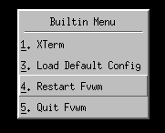
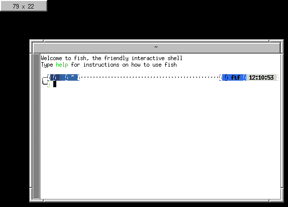
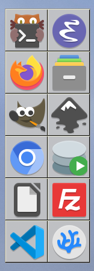
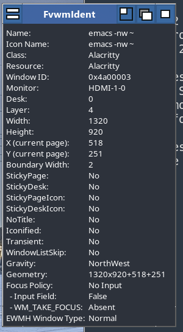
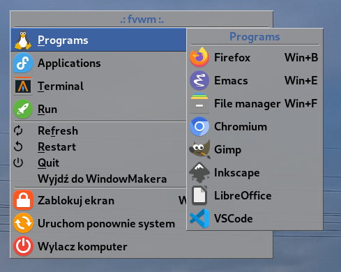
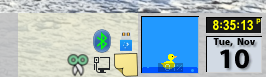
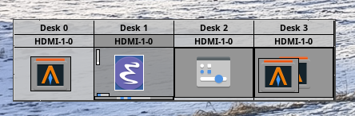
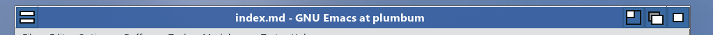
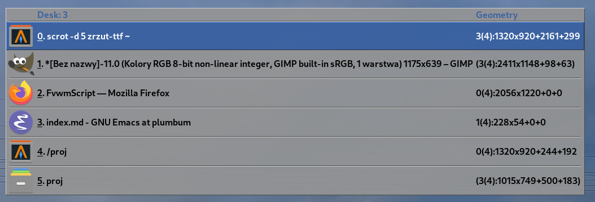

Configuring **FVWM** provides a great deal of joy, although that joy may occasionally be paid for with sleepless nights, missed deadlines, and other minor inconveniences.

Rome was not built in a day.

This is important to remember, along with patience, remaining calm, and maintaining good relations with the neighbors.

> The best way to remain calm is bigos. A perfectly respectable recipe appears at the end of this episode.

# Configuration Files

Much of the charm of configuring this magical window manager lies in constantly editing text files.

There is no official or widely used graphical control panel from which every aspect of FVWM can be clicked into place.

This has advantages.

The configuration consists of readable commands. It can be stored in Git, copied between computers, split into several files, and — most importantly — edited with an ordinary text editor.

> The author reluctantly admits that yes, _Vim_ is also perfectly capable of editing FVWM configuration and even provides rather decent syntax highlighting.
>
> Emacs is naturally better.

FVWM's default per-user directory is:

```text
~/.fvwm/
```

represented internally by:

```text
$FVWM_USERDIR
```

The most important file is:

```text
~/.fvwm/config
```

If it exists, FVWM uses it as the user's configuration.

If there is no user `config`, FVWM falls back to the configuration supplied with the program.

Since FVWM3 1.0.4 there is also a convenient middle ground:

```text
~/.fvwm/local.config
```

The supplied default configuration reads this file at the end, if it exists. This means we can keep the complete working default setup and override only the parts we actually care about.

That is a very sensible way to begin.

Not today.

Today we remove the anesthesia.

# The Absolutely Minimal Configuration

To demonstrate that the emperor's new clothes are completely invisible, create an empty configuration file:

```sh
mkdir -p ~/.fvwm
touch ~/.fvwm/config
```

and restart FVWM.

What appears before our eyes is...

darkness.

Darkness and a mouse pointer.

Nobody expected that, did they?

No panel.

No pager.

No clock.

No wallpaper.

Not very much to admire at all.

But **FVWM is running**.

# What Do We Still Have?

FVWM does not leave us entirely defenseless.

Even with an empty configuration file, there is a small set of built-in defaults and bindings.

Clicking the root window with the left mouse button opens a minimal menu.

Among other things, it allows us to:

- launch `xterm`,
- restart FVWM,
- get back to a starter configuration,
- quit the window manager.



**Restart** is about to become one of the most frequently used commands in our environment.

FVWM starts itself again and rereads the configuration.

If everything still looks wrong afterward?

Well.

That is probably our fault.

This is where the bigos comes in.

We already know the full supplied default configuration from the previous episode: panel, pager, window list, clock, menus, window decorations, and a useful collection of bindings.

Here we have almost nothing.

Almost.

## Alt-Tab

There is a built-in:

```text
M-Tab
```

or `Alt-Tab`.

Its behavior is not quite what users of mainstream desktop environments might expect.

It opens a window list which can be navigated, with the selected item confirmed using `Enter`.

The supplied FVWM default configuration later adds `SelectOnRelease`, producing behavior much closer to the modern Alt-Tab convention.

## Window Decorations

Windows still have minimal decorations:

- a title bar,
- borders,
- resize corners.

There are no title-bar buttons.

FVWM does not assume that the mere existence of a title bar means it must immediately contain a cross, a square, and a dash.

If we want buttons, we shall configure buttons.

## GeometryWindow

While interactively moving or resizing a window, a tiny geometry display may appear:



This is **GeometryWindow**.

It shows the current position or dimensions of the manipulated window and — like almost everything else in FVWM — can later be moved, recolored, configured, or disabled.

## Focus

There is an important distinction between the built-in behavior and the supplied default configuration.

FVWM's built-in focus policy is **MouseFocus**: a window receives keyboard focus when the pointer enters it and loses focus when the pointer leaves.

The supplied default configuration instead selects:

```text
SloppyFocus
```

which also gives focus when the pointer enters a window, but does not discard that focus merely because the pointer later moves over the empty root window.

This style has a long tradition in the X11 world.

And, more importantly, it is remarkably comfortable once one gets used to it.

# What Can Be Configured?

From this point onward, the user's task is to turn FVWM into something which:

1. looks acceptable,
2. provides everything we need,
3. is pleasant to use,
4. will never be considered finished.

This is a continuous process with no well-defined completion date.

There is always something that can be rewritten.

Or redrawn.

Or moved three pixels to the left.

What can we configure?

- **window decorations** — title bars, borders, handles, buttons, colors, textures, raster and vector icons,
- **window behavior** — focus policy, maximization, iconification, stickiness, shading, moving, resizing, and window menus,
- **menus** — contents, appearance, submenus, shortcuts, and behavior,
- **desktop icons for iconified windows** — or their complete absence,
- **keyboard shortcuts** for practically every operation available,
- **mouse bindings depending on context** — one behavior on the desktop, another on the title bar, frame, or module,
- **per-application styles**.

That last one is particularly entertaining.

Emacs, a terminal, Firefox, and any other application can all have different decorations, behavior, placement rules, and window policies.

Provided we have enough time and artistic determination.

Which naturally means we will do exactly that.

# Modules

One of FVWM's greatest strengths is its collection of **modules**.

Modules are separate processes launched by the main window manager as needed. They communicate with FVWM and provide functionality that does not need to live permanently inside the core process.

There are several advantages.

Nothing has to run unless we actually use it.

Individual pieces can be replaced and configured independently.

And a module failure does not necessarily bring down the window manager itself.

Among the more interesting modules shipped with FVWM3 are:

## FvwmButtons

Probably the most versatile of the lot.

It can be used to build:

- panels,
- docks,
- launchers,
- collections of buttons,
- containers for other FVWM modules,
- and even embedded windows from other applications.

With `FvwmButtons`, a desktop can quite literally be assembled from building blocks.

The main limit is usually imagination.

And time.

Fortunately, FVWM uses little enough memory that RAM is not yet the principal obstacle.

## FvwmPager

Displays a miniature view of virtual desktops, pages, and the windows living on them.

It can do more than merely show where we are: desktops and pages can be selected, and windows can even be moved around through the pager.

## FvwmIconMan

A highly configurable window-list manager.

It can behave somewhat like a taskbar, but multiple instances can also be launched, each displaying an entirely different subset of windows.

For example:

```text
all windows
```

in one place, and:

```text
Emacs only
```

somewhere else.

Because why not?

## FvwmBacker

Reacts to desk or page changes and executes configured actions.

Its most obvious use is changing the wallpaper.

Which means every desktop can have a different background.

But because the action can be an arbitrary FVWM command, wallpapers are only the beginning.

## FvwmAnimate

Animates window iconification and de-iconification.

Several effects are available.

This is not remotely essential to productive work.

Which naturally means it must be tested.

## FvwmRearrange

Rearranges existing windows:

- tiled,
- or cascaded.

Useful after spending several minutes carefully scattering twelve terminals across the entire screen.

## FvwmScript

A scripting engine for building small graphical applications associated with FVWM.

It can be used to create:

- widgets,
- small control panels,
- desktop accessories,
- simple interactive tools.

So when ordinary window-manager configuration is no longer enough, we may begin writing applications inside the window-manager configuration.

Of course.

## FvwmForm

A simpler mechanism for creating forms and dialog windows.

It supports things such as:

- labels,
- text input,
- mutually exclusive and multiple-choice selections,
- action buttons.

Perfect for displaying:

> Are you sure you want to end the session?

instead of relying on one's own reflexes.

## FvwmAuto

Executes actions when the mouse pointer enters or leaves a window, optionally after a configurable delay.

The traditional example is automatically raising a window.

It can also be used for automatically showing and hiding panels.

## FvwmEvent

An event daemon.

It listens for events generated by FVWM and may run functions or commands in response.

It can react to events such as:

- focus changes,
- desk or page changes,
- iconification and de-iconification,
- maximization,
- other window-state changes.

In other words:

> if X happens, do Y.

And probably Z as well.

Because we can.

## FvwmIdent

A diagnostic tool which becomes surprisingly useful while writing a configuration.

Select a window and `FvwmIdent` displays detailed information about it, including things such as:

- its name,
- X11 class,
- resource name,
- window identifier,
- geometry,
- FVWM state and properties.

This is invaluable when writing:

```text
Style
```

rules.

Before we say:

> every window belonging to this application should behave like this,

it helps to know how FVWM actually identifies that application.

# A Few Results

Below are several styles, decorations, and modules in actual use.

## FvwmButtons



## FvwmIdent



## Menus



## Embedded Applications



## Pager



## Window Decorations



## Window List



Not everything at once.

Not immediately.

First we need to decide where to start.

Then change it fourteen times.

# A Bigos Recipe

And now the promised bigos recipe.

After all, one cannot spend the entire evening restarting a window manager.

## Ingredients

- 1 kg sauerkraut,
- 1 kg fresh white cabbage,
- about 500 g pork shoulder or neck,
- about 300 g beef,
- 300–500 g bacon, preferably smoked,
- 200–300 g good sausage, preferably smoked or juniper-flavored,
- about 50 g dried mushrooms, preferably porcini,
- a handful of dried or smoked plums,
- 1–2 onions,
- 3–4 bay leaves,
- 5–6 allspice berries,
- a few cloves,
- a little caraway,
- marjoram,
- salt,
- freshly ground black pepper,
- optionally, a glass of dry red wine.

## Algorithm

1. Cover the dried mushrooms with hot water and leave them for 30–60 minutes. Drain and slice them, keeping the soaking liquid.
2. Lightly squeeze the sauerkraut. If it is extremely sour, rinse it first. Chop it, add a little water or mushroom stock, then begin cooking it with bay leaves and allspice.
3. Shred the fresh cabbage, blanch or briefly boil it, then combine it with the sauerkraut.
4. Fry the diced bacon in a pan or heavy pot.
5. Add chopped onions and diced pork and beef. Cook until the meat is properly browned.
6. Fry the sliced sausage separately and add it somewhat later.
7. Add the meat, mushrooms, part of the mushroom liquid, chopped dried plums, and the remaining spices to the cabbage.
8. Mix thoroughly and simmer over low heat for at least 2–3 hours, stirring occasionally so that nothing sticks to the bottom.
9. If using wine, add it during cooking.
10. Reheat the whole thing the following day.

That last step is not strictly required by the parser.

It does, however, significantly improve the result.

Unfortunately, no suitable screenshot is currently available.
